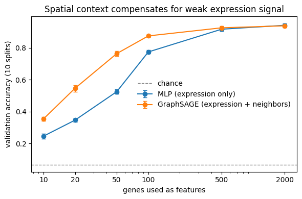
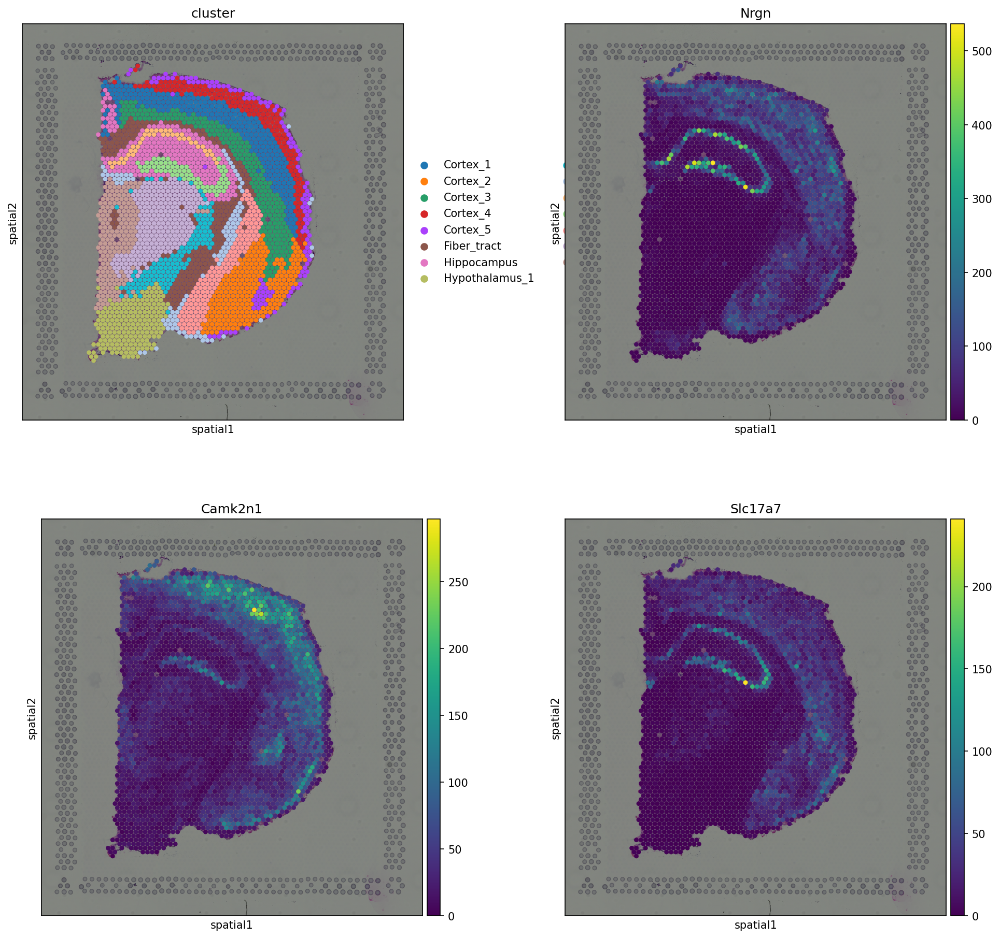

# Spatial context in Visium spatial transcriptomics

Two connected analyses on the same 10x Visium mouse brain section:

1. **GNN vs MLP:** When does knowing a spot's neighbors help predict its brain region?
2. **Spatially variable genes:** Which genes carry spatial signal, and does that signal trace anatomy?

**Throughline:** Both analyses use the same 6-neighbor spatial graph. Project 1 uses it to *average* neighbors inside a model, and Project 2 uses it to *score* whether neighbors agree.

---

## Data

10x Visium mouse brain coronal section (H&E), loaded via `squidpy.datasets.visium_hne_adata()`.

- 2,688 spots, each with an expression profile and (x, y) tissue coordinates
- 15 annotated regions (cortex layers, hippocampus, thalamus, fiber tract, etc.), provided with the dataset by squidpy (expression clustering, named against the Allen Brain Atlas)
- Log-normalized expression; highly variable genes selected per analysis

**Graph:** each spot connected to its 6 hexagonal neighbors (`squidpy.gr.spatial_neighbors`, grid mode). Edge homophily = 0.76 (76% of edges join same-region spots).

---

## Project 1: When does spatial context matter? GNNs vs MLPs

**Question:** Does knowing a spot's physical neighbors help predict which brain region it belongs to, beyond what its own gene expression already says?

**Answer:** Not when expression is rich. But as the expression signal weakens, a graph neural network that uses neighbors outperforms an expression-only model by up to 24 accuracy points. Spatial context acts as a denoiser: it helps most when each spot carries partial information.

### Approach

Node classification: predict each spot's region label. All models share the same training loop, splits, and hyperparameters; the only difference is whether, and how, a spot sees its neighbors.

| Model | What each spot sees |
|---|---|
| **MLP** | Its own expression only |
| **GCN** (`GCNConv`) | The average of itself and its neighbors |
| **GraphSAGE** (`SAGEConv`) | Its own features and the neighbor mean, through separate learned weights |

**Training:** 2-layer models, hidden size 128, dropout 0.5, Adam (lr 1e-3, weight decay 5e-4), full-batch, transductive setting. 80/20 stratified split; results averaged over 10 random splits with paired comparisons.

### Results

**1. GCN underperforms; GraphSAGE recovers.** With 2,000 genes on a single split, GCN scored **89.4%** vs the MLP's **92.8%** and failed to fit the training set (95% train accuracy). GCN replaces each spot's features with a neighborhood average, so a spot's own signal becomes ~1/7 of its input and region boundaries blur (oversmoothing). GraphSAGE keeps self and neighbor information on separate tracks and recovered full training fit.

**2. With full expression, spatial context adds nothing.** Across 10 splits at 2,000 genes: **MLP 0.943 ± 0.013**, **GraphSAGE 0.939 ± 0.012** (SAGE wins 2/10). This is expected: the region labels were derived from expression, so a spot's own profile already determines its label.

**3. As expression weakens, spatial context takes over.** Features were restricted to the top *k* most variable genes:

| Genes | MLP | GraphSAGE | Gap | SAGE wins (of 10) |
|---:|---:|---:|---:|---:|
| 2000 | 0.942 | 0.938 | −0.003 | 3 |
| 500 | 0.917 | 0.926 | +0.009 | 8 |
| 100 | 0.774 | 0.875 | +0.101 | 10 |
| 50 | 0.525 | 0.764 | **+0.239** | 10 |
| 20 | 0.346 | 0.546 | +0.200 | 10 |
| 10 | 0.246 | 0.354 | +0.108 | 10 |

The gap follows an inverted U. Neighbor aggregation fills in missing information when each spot has *partial* signal, but cannot create signal that isn't there: at 10 genes, every neighbor is weak too.

### Takeaways

- A layer's built-in assumption about the data matters as much as model capacity: GCN assumes a spot resembles its neighborhood average, while GraphSAGE learns how much to trust it.
- Spatial information is most valuable in the sparse-signal regime, which is the setting of high-resolution platforms (e.g., Visium HD, Xenium) where each spot or cell captures fewer transcripts.

---

## Project 2: Spatially variable genes recover brain anatomy

*Same notebook as Project 1, in the later cells.*

**Question:** Which genes have expression that is patterned in space, rather than scattered randomly?

**Answer:** Without using region labels, the top-scoring genes each trace distinct brain structures. In this tissue, anatomy is the main source of spatial patterning: each region has its own cell types, each cell type runs its own genes, and regions are large contiguous blocks.

*Top left: annotated regions for reference. Other panels: the top 3 genes by Moran's I.*

### Approach

**Moran's I** scores each gene by whether neighboring spots share similar expression:

- **I ≈ +1:** clustered (like-near-like), so spatially variable
- **I ≈ 0:** random, with no spatial pattern
- **I ≈ −1:** dispersed (checkerboard-like)

$$I = \frac{N}{W}\cdot\frac{\sum_i \sum_j w_{ij}(x_i-\bar{x})(x_j-\bar{x})}{\sum_i (x_i-\bar{x})^2}$$

where $x_i$ is expression at spot $i$ and $w_{ij} = 1$ if spots $i$ and $j$ are neighbors (the same graph as Project 1).

**Pipeline:**
1. Select the top 3,000 highly variable genes.
2. Build the 6-neighbor spatial graph.
3. Score every gene with `sq.gr.spatial_autocorr(mode="moran")`, using 100 permutations and Benjamini–Hochberg FDR correction.
4. Plot the top genes on the tissue, with the lowest-scoring genes as a negative control.

### Results

- The top-ranked genes each paint a recognizable anatomical structure that lines up with the annotated regions.
- The lowest-scoring genes look like salt-and-pepper noise, which confirms that the score separates patterned from random expression.
- Gene patterns partly cross annotated region borders. This is expected: many genes mark cell types that span regions (e.g., myelin genes along fiber tracts), each ~55 µm spot mixes several cells, and the annotations are coarse.

### Takeaways

- Moran's I measures *pattern*, not expression level: a gene scores high because its neighbors agree, not because it is highly expressed.
- High–Moran's I genes are exactly the signals that neighbor aggregation (Project 1) can reinforce.

---

## Limitations

- Region labels were derived from expression clustering, which caps how much location can help in Project 1 at full gene coverage. Anatomically annotated labels would be a stronger test.
- Gene restriction is a proxy for sparse signal; downsampling counts would more directly mimic low-depth data.
- Moran's I detects clustering but not the shape of a pattern, and its results reflect a standard analysis (also shown in the squidpy tutorials) rather than a new method.
- Single tissue section; generalization to other tissues (e.g., finely mixed tumor tissue) is untested.

## Next steps

- Rerun the Project 1 gene-cut experiment using the top 50 spatially variable genes vs 50 random genes, to test whether the GNN's advantage depends on genes carrying spatial signal.
- Repeat both analyses on contrasting tissues and higher-resolution platforms.

## Run it

Open the notebook in Colab (badge above), set **Runtime → T4 GPU** (needed for Project 1 only), and run all cells. Dependencies: `torch`, `torch_geometric`, `squidpy`, `scanpy`.
